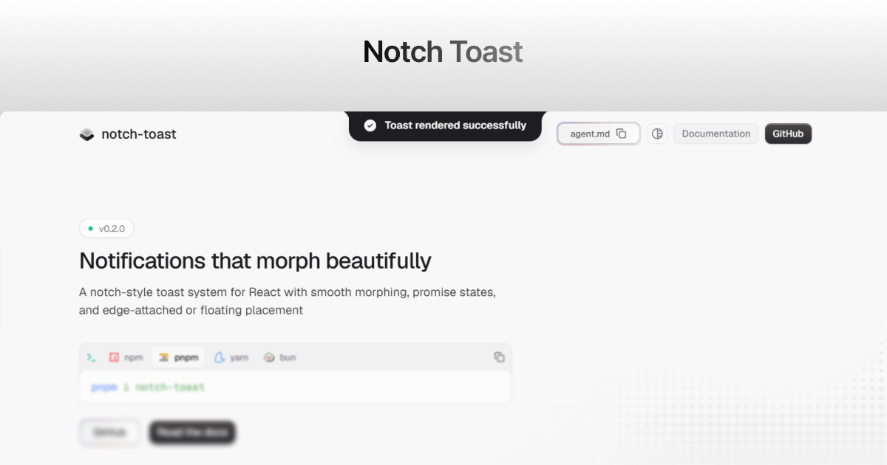

<div align="center">
  

# Notch Toast

An open-source React toast library that turns notifications into a polished, morphing notch or floating surface.

[](https://notch.devsethi.me)
[](https://github.com/Devsethi3/notch-toast)
[](./LICENSE)
[](./CODE_OF_CONDUCT.md)

  <br />

<!-- [Features](#features) • [Quick Start](#quick-start) • [API](#api) • [Contributing](#contributing) • [License](#license) -->



---

</div>

## Overview

Notch Toast is a lightweight, client-side notification system for React. It
renders one focused toast at a time, morphs updates in place, and supports a
notch attached to the viewport edge or a floating notification surface.

It is built for apps that want a deliberate, polished notification experience
without a queue of competing messages.

## Features

- Six toast types: default, success, error, warning, info, and loading.
- Morphing updates for a single active notification.
- Promise lifecycle notifications.
- Attached notch and floating display modes.
- Top-center and bottom-center placement.
- Five motion presets plus reduced-motion support.
- Optional action and dismiss controls.
- Accessible live-region announcements and Escape-key dismissal.
- TypeScript types, React 18/19 support, and Motion peer compatibility.
- shadcn registry and coding-agent skill installation paths.

## Quick start

### Install

Install the package and its Motion peer dependency:

```bash
npm install notch-toast motion
```

```bash
pnpm add notch-toast motion
```

### Mount one toaster

Mount `NotchToaster` once near the application root. It is a client component
that can safely be rendered from a Next.js layout.

```tsx
import { NotchToaster } from "notch-toast"

export default function RootLayout({
  children,
}: Readonly<{ children: React.ReactNode }>) {
  return (
    <html lang="en">
      <body>
        {children}
        <NotchToaster />
      </body>
    </html>
  )
}
```

No separate stylesheet import is required: the package includes the styles used
by the toaster.

### Trigger a toast

Trigger toasts from a client component or other browser-side code:

```tsx
"use client"

import { toast } from "notch-toast"

export function SaveButton() {
  return (
    <button onClick={() => toast.success("Changes saved")}>Save changes</button>
  )
}
```

## Usage

### Toast types

```tsx
toast("A new notification")
toast.success("Profile updated")
toast.info("New version available")
toast.warning("Your session expires soon")
toast.error("Unable to save changes")
toast.loading("Uploading file")
```

| Type      | Default duration | Dismissible by default |
| --------- | ---------------: | :--------------------: |
| `default` |          3600 ms |           No           |
| `success` |          3600 ms |           No           |
| `info`    |          3600 ms |           No           |
| `warning` |       Persistent |          Yes           |
| `error`   |       Persistent |          Yes           |
| `loading` |       Persistent |          Yes           |

Set `duration: 0` to keep any toast visible until it is dismissed or updated.

### Options and actions

```tsx
toast.error("Could not save your changes", {
  duration: 0,
  dismissible: true,
  action: {
    label: "Retry",
    onClick: retrySave,
  },
})
```

| Option        | Type                 | Description                                                                         |
| ------------- | -------------------- | ----------------------------------------------------------------------------------- |
| `id`          | `string`             | A stable ID for updating or dismissing a toast.                                     |
| `duration`    | `number`             | Time in milliseconds before dismissal; `0` keeps it open.                           |
| `dismissible` | `boolean`            | Shows the close control. Defaults to `true` for error, warning, and loading toasts. |
| `action`      | `{ label, onClick }` | Adds an action button to the toast.                                                 |

### Update or dismiss

Notch Toast intentionally displays the latest notification. Reuse an ID to
morph the current notification in place.

```tsx
const id = toast.loading("Saving settings", { id: "save-settings" })

toast.update(id, {
  title: "Settings saved",
  type: "success",
  duration: 3600,
  dismissible: false,
})

toast.dismiss(id)
// Or dismiss whichever toast is active:
toast.dismiss()
```

### Promise states

`toast.promise` displays a loading state and replaces it only if it is still
the active toast when the promise settles.

```tsx
await toast.promise(saveSettings(), {
  loading: "Saving settings",
  success: "Settings saved",
  error: (reason) =>
    reason instanceof Error ? reason.message : "Unable to save settings",
})
```

### Configure the toaster

```tsx
<NotchToaster position="bottom-center" mode="floating" animation="smooth" />
```

| Prop        | Values                                         | Default      |
| ----------- | ---------------------------------------------- | ------------ |
| `position`  | `top-center`, `bottom-center`                  | `top-center` |
| `mode`      | `attached`, `floating`                         | `attached`   |
| `animation` | `fluid`, `gooey`, `smooth`, `subtle`, `snappy` | `fluid`      |

Mount exactly one `NotchToaster` per app. The component uses a singleton,
latest-toast-wins store.

## Accessibility

Status messages are announced through live regions without moving focus.
Errors use an assertive announcement; other toast types use polite
announcements. Dismissible toasts can be closed with their close button or the
Escape key, except while focus is inside an editable control. Reduced-motion
preferences keep a brief opacity transition while removing movement.

## shadcn/ui

Install the thin local wrapper in `components/ui`. The registry handles the
package and Motion dependency:

```bash
npx shadcn@latest add https://notch.devsethi.me/r/notch-toaster.json
```

Then mount the generated `NotchToaster` once and use `notchToast` from the
generated component.

## AI agents and skills

Install the bundled agent guidance from the skills registry:

```bash
npx skills add Devsethi3/notch-toast
```

Or install the guidance directly from the package:

```bash
npx notch-toast add-skill
npx notch-toast add-skill --agents
npx notch-toast add-skill --dir .cursor/skills/notch-toast
```

The full guidance is available at [agents.md](https://notch.devsethi.me/agents.md).

## Documentation and support

- [Documentation](https://notch.devsethi.me/docs)
- [Changelog](https://notch.devsethi.me/changelog)
- [Report a bug or request a feature](https://github.com/Devsethi3/notch-toast/issues)
- [Security policy](./SECURITY.md)

## Development

### Prerequisites

- Node.js 20 or later
- pnpm 9 or later

### Run the project

```bash
git clone https://github.com/Devsethi3/notch-toast.git
cd notch-toast
pnpm install
pnpm dev
```

### Useful commands

```bash
pnpm typecheck       # Check the site and workspace TypeScript
pnpm lint            # Run ESLint
pnpm test            # Run package unit tests
pnpm test:package    # Run unit and consumer smoke tests
pnpm build           # Create the production site build
pnpm --filter ./packages/notch-toast run build
pnpm --filter ./packages/notch-toast run pack:check
```

### Repository layout

```text
app/                         Next.js marketing site, documentation, and metadata
components/                  Site components and UI primitives
packages/notch-toast/        Published React package, tests, CLI, and skill
public/r/notch-toaster.json  shadcn registry entry
tests/                       Shared test configuration
```

## Contributing

Contributions are welcome. Read [CONTRIBUTING.md](./CONTRIBUTING.md) for setup,
quality checks, pull-request expectations, and the complete fork workflow.
Please also follow the [Code of Conduct](./CODE_OF_CONDUCT.md).

### Fork workflow

1. Fork [Devsethi3/notch-toast](https://github.com/Devsethi3/notch-toast) on GitHub.
2. Clone your fork and configure the canonical repository as `upstream`:

   ```bash
   git clone https://github.com/YOUR-USERNAME/notch-toast.git
   cd notch-toast
   git remote add upstream https://github.com/Devsethi3/notch-toast.git
   git fetch upstream
   ```

3. Create a focused branch, make the change, and run the relevant checks.
4. Push your fork and open a pull request against the default branch.

## License

Distributed under the [MIT License](./LICENSE). Copyright © 2026
notch-toast contributors.

## Author

Created and maintained by [Dev Sethi](https://devsethi.site). Follow updates on
[X](https://x.com/imsethidev).
